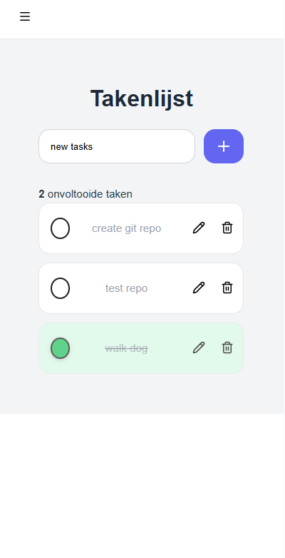

# ToDoListApp

A simple, mobile-friendly to-do list. I built it as an assessment for a job application.


## Status

Finished. This was an individual assessment and I built everything myself in about a day, because it was not my main priority at the time.

## Technologies

- React 19
- Vite
- Material UI (MUI) with Emotion
- React Router
- lucide-react icons

## Features

- Add, edit and delete tasks
- Tasks are crossed out when they are done
- Multiple pages
- Clean, mobile-friendly interface

## Project structure

The app lives in the `ToDoListApp/` folder. Run all commands from that folder.

```
.
├── ToDoListApp/    # The React application
├── docs/           # Screenshot used in this README
└── README.md
```

## How to run it

You need Node.js 18 or newer.

```bash
git clone https://github.com/MerijnSnelders/ToDoListApp.git
cd ToDoListApp/ToDoListApp
npm install
npm run dev
```

Other scripts:

- `npm run build` creates a production build
- `npm run preview` serves the production build locally

## Process

I started by reading the assessment requirements and setting up the project. Then I built the main task list, added the remaining features and tidied up the code. The whole project took about a day.

## What I learned

- State management
- Structuring a small app

## How it could improve

- Improve the general design, which could look better
- Remove the committed `node_modules/` folder and add a `.gitignore`
- Remove the duplicate `@vitejs/plugin-react` entry in `package.json`

## Preview


